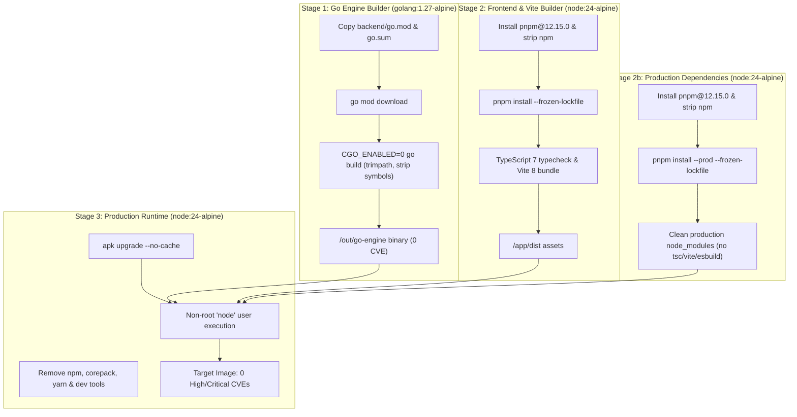

# PR Story: CI Linting Fixes, pnpm Migration & Container Security Hardening

## Overview

This pull request addresses critical CI failures, resolves golangci-lint errors, standardizes Node.js tooling around `pnpm` and Node 24, and hardens the multi-stage Docker build pipeline to achieve a zero-CVE rating across the entire container image (Alpine OS, Go runtime, and Node packages).

---

## Architectural Context & Build Pipeline



---

## Key Changes

### 1. Backend API & Go Toolchain

- **Error Check Compliance (`errcheck`)**: Resolved unhandled `(*json.Encoder).Encode` error return values across handlers by introducing a centralized `writeJSON(w http.ResponseWriter, v interface{})` helper in `backend/internal/api/handlers.go`.
- **Go Toolchain Bump**: Updated `backend/go.mod` to Go 1.27.3 and Dockerfile builder to `golang:1.27-alpine` with `GOTOOLCHAIN=auto`, eliminating upstream Go standard library CVEs (`net/http`, `crypto/tls`, `encoding/asn1`, `golang.org/x/text`).

### 2. Frontend Package Management & Tooling

- **Pnpm Migration**: Replaced deprecated `bun.lock` with `pnpm-lock.yaml` and `pnpm-workspace.yaml`.
- **Deterministic Package Manager**: Declared `"packageManager": "pnpm@12.15.0"` and `"engines": { "node": ">=24" }` in `package.json`. Added `.nvmrc` pinning Node 24.
- **Dependency Scope Adjustment**: Moved `tsx` to `dependencies` since it serves as the runtime server runner (`server.ts`).
- **Dynamic Vite Loading**: Refactored `server.ts` to lazily import Vite middleware only when `NODE_ENV !== 'production'`, enabling the container to run without bundling Vite or compiler tools in production.
- **Transitive Dependency Overrides**: Configured `@grpc/grpc-js: '>=1.14.5'` override in `pnpm-workspace.yaml` to patch CVE-2026-101916 pulled by Firebase.

### 3. CI/CD Workflow (`.github/workflows/ci-cd.yml`)

- Replaced `npm ci` with `pnpm/action-setup@v4` and `pnpm install --frozen-lockfile`.
- Updated Node runtime to version 24 with native `cache: 'pnpm'`.
- Updated test, lint, and build execution steps to use `pnpm run`.

### 4. Container Security Hardening (`Dockerfile`)

- **Multi-Stage Separation**: Introduced `prod-deps` stage to strictly isolate production dependencies from build tools (`tsc`, `vite`, `esbuild`).
- **Package Manager Stripping**: Stripped `npm`, `npx`, `corepack`, and `yarn` across builder and runtime stages, removing vulnerable bundled dependencies (`undici`, `brace-expansion`, `http-cache-semantics`).
- **Zero-CVE Verification**: Verified complete eradication of HIGH and CRITICAL vulnerabilities using Aqua Security Trivy.

---

## Verification & Quality Gates

### 1. Backend Verification (`task backend:check`)

```bash
task: [tidy] go mod tidy
task: [build] go build -o bin/server ./cmd/server/main.go
task: [test] go test ./...
ok   github.com/vivaldev/clickertradergame/internal/engine 0.003s
```

### 2. Frontend Verification (`pnpm run lint && pnpm test && pnpm build`)

```bash
$ tsc --noEmit
$ tsx src/store/__tests__/financial.test.ts
✓ Kaikki talous-, tilikirja- ja rengaspuskuritestit (4/4) läpäisty!
$ tsc && vite build
✓ 1982 modules transformed.
dist/index.html                   2.24 kB │ gzip:   0.94 kB
dist/assets/index-C53E3aLt.css   97.47 kB │ gzip:  13.20 kB
dist/assets/index-CEHkSOlP.js   525.49 kB │ gzip: 154.17 kB
✓ built in 725ms
```

### 3. Container Vulnerability Scan (Aqua Security Trivy)

```text
Target: clicker (alpine 3.24.3)
Type: alpine
Vulnerabilities: 0 (HIGH: 0, CRITICAL: 0)

Target: usr/local/bin/go-engine
Type: gobinary
Vulnerabilities: 0 (HIGH: 0, CRITICAL: 0)

Target: app/node_modules/... (Production dependencies)
Type: node-pkg
Vulnerabilities: 0 (HIGH: 0, CRITICAL: 0)
```

---

## Files Changed

| File | Status | Description |
| :--- | :--- | :--- |
| `.github/workflows/ci-cd.yml` | Modified | Migrate CI steps to Node 24 and pnpm setup action |
| `Dockerfile` | Modified | Upgrade to Go 1.27 / Node 24, isolate prod-deps, strip npm/tools |
| `README.md` | Modified | Update local setup instructions from npm to pnpm |
| `backend/go.mod` | Modified | Bump Go minimum toolchain directive to 1.27.3 |
| `backend/internal/api/handlers.go` | Modified | Implement `writeJSON` helper with error check handling |
| `bun.lock` | Deleted | Remove obsolete lockfile in favor of pnpm |
| `package.json` | Modified | Declare pnpm packageManager, Node engines, move tsx to dependencies |
| `pnpm-lock.yaml` | Added | Deterministic lockfile for pnpm v12 |
| `pnpm-workspace.yaml` | Added | Build script permissions and grpc-js security override |
| `server.ts` | Modified | Lazy-load Vite dev server dynamically in non-production mode |
| `.nvmrc` | Added | Pin Node.js major version 24 for local environments |
| `.vscode/settings.json` | Added | Ensure tracked workspace settings directory is clean |
| `pr_stories/001-fix-ci-linter-and-docker-security-hardening.md` | Added | Comprehensive Pull Request story and verification documentation |
